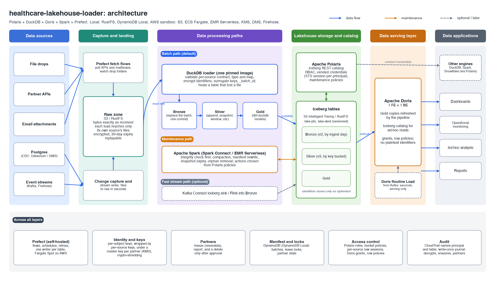

# healthcare-lakehouse-loader

Load regulated health data into an Apache Iceberg lakehouse, on a laptop with one command or in
AWS. Files from outside sources are kept exactly as received, validated against a per-source
contract, encrypted at the identifier level, and loaded by **DuckDB** into Iceberg tables (Bronze,
Silver, Gold) through the **Apache Polaris** catalog. **Apache Spark** maintains the tables,
**Apache Doris** serves them, and **Prefect** orchestrates everything.



**Synthetic data only.** The stack generates its own fake members, claims and lab results. Never
put real PHI in it.

## Highlights

- **A contract per source, nothing else.** A YAML file declares format, columns, PHI classes, the
  primary key and how Silver absorbs a batch. Adding a file-drop source needs only that file.
- **Five ways in:** file drops, partner HTTP APIs, email attachments, change data capture and
  event streams, all converging on the same pipeline.
- **Identifiers encrypted before Bronze**, per subject, with AES-256-GCM. **Erasure is
  crypto-shredding**: delete one key and every copy of a person's identifiers, in every layer,
  snapshot and backup, becomes unreadable at once.
- **Least privilege by construction.** Every engine reaches storage only with credentials the
  catalog vends for one table; every load reaches the raw zone only with credentials for its own
  source's files; bucket policies refuse everything else.
- **Partners isolated without separate buckets**, each with its own master key. A partner can be
  frozen at once and reversibly, and its data deleted only after an approved, recorded sign-off.
- **Idempotent and self-healing.** Every step is replayable by batch; a writer that finds a lost
  data file repairs its table before continuing.
- **Measured.** Benchmarks locally and on AWS, each step capped like the production task, with the
  cost at a mid-size payer's volume.

## Quick start

Needs Docker with about 8 GB of memory for containers, Python 3 on the host, and `make`.

```sh
make up       # build images, start everything, wait until healthy
make demo     # drop synthetic files for three example sources and load them
make verify   # run every test suite
make down     # stop (keeps data); `make clean` also deletes volumes
```

`COMPOSE_PROFILES= make up` starts everything except Doris. `make test ARGS="tests/access -q"`
runs one suite. Local secrets (master key, identity pepper, passwords) are generated into `.env` on
the first `make up`.

One folder owns the local stack, because the Compose project name is fixed. The stack targets refuse
to run from a git worktree, or while the stack is running from another checkout (`make down` there first).

## How a file gets loaded

Each source has a contract in `contracts/`: the partner it comes from, file format, columns with
their Iceberg type and PHI class (`none`, `phi` or `identifier`; unclassified means `phi`), columns
to drop, the primary key, and how Silver absorbs a batch (`append`, `snapshot`, `window` or `cdc`).

1. **Drop.** A file arrives in `raw/drops/<source>/`. The source's Prefect deployment polls on the
   contract's interval.
2. **Land.** The bytes are copied unchanged to `raw/landed/<source>/<entity>/ingest_date=/batch_id=/`.
   The batch ID comes from the content hash, so a re-dropped file is a no-op. Original file names
   are never kept, only their hash: partners put patient names in them.
3. **Bronze.** DuckDB validates the file against the contract (declared columns only, types,
   primary key) and drops what the contract drops. A bad file goes to `raw/quarantine/` with a
   reason that names columns and counts, never values. Otherwise identifiers are encrypted and the
   batch replaces any earlier copy of itself in Bronze, in one transaction.
4. **Silver.** The batch is applied per the contract's semantics, in one transaction. `append` and
   `cdc` tables are partitioned by a hash bucket of the primary key, so a merge reads only the
   buckets its keys fall in; existing tables move to that layout by partition evolution on deploy.
5. Every step is recorded in a DynamoDB manifest, and every table write holds that table's lease
   lock. Reruns are idempotent, and `pipeline.replay` rebuilds both layers from the raw zone.

Each source writes with its own Polaris principal, granted only its two tables, and reads the raw
zone with short-lived credentials admitting only its own prefixes (an STS session policy: against a
raw-access role on AWS, against RustFS locally).

### Sources

How data arrives (`fetch` in the contract) only changes step 1:

| `fetch.kind` | What happens | Example |
|---|---|---|
| `file_drop` | The partner drops files | `acme_claims`, `provider_directory`, `lab_results` |
| `http_api` | The loader requests the last `days_back` days from the partner's API, page by page, and lands all pages as one batch, so a restated window replaces what came before | `acme_encounters` (a mock partner API in the stack) |
| `email` | Attachments from allowed senders, delivered to the contract's mailbox (SES inbound on AWS, an SMTP receiver locally), are dropped; message bodies and attachment names are never kept; other mail is quarantined | `acme_lab_mail` |
| `staged` (CDC) | A capture tool (AWS DMS, or Debezium locally) writes change files to its own staging bucket; each fetch moves them into the drop prefix. Silver's `cdc` semantics apply the latest change per key, deletes included, and ignore stale changes | `acme_clinic_patients` |
| `stream` | Events published to the source's topic are written into its drop prefix in small files (Redpanda Connect every 10 seconds locally, Firehose on AWS); delivery is at least once, and repeats load once | `acme_vitals` |

API tokens come from `.env` locally and Secrets Manager on AWS; they never appear in contracts,
errors or logs.

## Identifiers, erasure and re-identification

- **Subjects and people.** A contract that keeps identifier columns names a subject key (such as
  `member_id`). The identity service maps it, through a blind index (HMAC with a secret pepper), to a
  random per-source `subject_id`; a `person_id` links subjects believed to be the same person.
  Linking and splitting never touch lake data.
- **Encryption.** Each subject has its own AES-256 data key, wrapped by its source's
  key-encryption key, itself wrapped by its partner's master key (a KMS key per partner on AWS).
  Every identifier value is encrypted with AES-256-GCM, bound to its subject and column. A batch
  makes one KMS request, however many members it mentions.
- **Erasure.** `python -m loader.cli shred --person <id> ...` writes a write-once journal entry
  (S3 Object Lock), deletes the person's keys and identity entries, and deletes the raw files that
  mentioned them. Nothing in the lake is rewritten: what remains is unreadable.
- **Backups cannot undo a shred.** A vault restore locks the vault, re-applies the whole journal,
  and only then serves keys.
- **Re-identification is narrow and audited.** `python -m loader.cli reidentify ...` takes named
  subjects, a role and a purpose, checks them against policy (`decrypt_policy` in
  `stack/bootstrap/model.json`), caps subjects per call, and records every call, allowed or
  refused, write-once, before anything is decrypted. Values are never logged.
- **The raw zone expires** after 30 days: it holds plaintext and cannot be shredded per subject.

## Partners and offboarding

Several sources can come from one partner (`partner` in the contract). Each partner has its own
master key, wrapping the key-encryption keys of all its sources, and its own put-only identity for
dropping files. Offboarding a partner happens in three steps; deleting its data is a decision for
leadership and legal, so the irreversible step runs only after their sign-off:

| Step | Command | Effect | Reversible |
|---|---|---|---|
| Freeze | `loader.cli partner freeze <p> --actor ... --reason ...` | The partner's master key is disabled, so every identifier of the partner is unreadable in every layer, snapshot, backup and Doris copy at once; its drop identity is disabled, its schedules pause, and its sources stop loading. Can stand indefinitely, for a legal hold | Yes: `partner unfreeze` |
| Report | `loader.cli partner report <p> --out report.json` | Read-only inventory of everything a delete would remove (tables, rows, raw files, identity and key entries, principals, schedules, Gold models and Doris copies built from the partner's data), as names and counts, with a hash recorded in the journal | n/a |
| Delete | `loader.cli partner delete <p> --request <ticket> --approver <a> --approver <b> --report-hash <h> --gold drop\|keep --actor ...` | Refuses unless the partner is frozen, two different approvers are named, and a fresh report has the approved hash. Records the approval write-once, then removes the master key, the tables, the raw files, the identity and key entries, the principals and schedules, and (with `--gold drop`) the Gold tables and Doris copies built from the partner's data. Resumes where it stopped if interrupted | No |

On AWS no task can delete a partner's master key: its key policy reserves that for a
`partner-deletion` role that only the operator's own SSO identity can assume. After approval the
operator runs `scripts/sandbox.py schedule-key-deletion <partner>`, then the delete; KMS's waiting
period (30 days) is the last chance to cancel (`cancel-key-deletion`). Gold models that read a
deleted partner's tables must be changed in dbt before the next Gold run; the report lists them,
including models that read them through other Gold models (it follows dbt's dependency graph).
Existing key-encryption keys move under their partner's master key with `loader.cli rewrap-keks`.

## Gold and serving

- **Gold** is a dbt project (`dbt/`) on DuckDB that reads Silver (and Bronze, where it needs
  history) and writes only Gold, models after the models they read, each table in one
  transaction. Most tables are replaced whole on every run; `dim_provider` is incremental.
  - A dimensional core in `phi.gold`, not served: `dim_provider`, the provider directory as SCD
    type 2 (a version per change; `valid_from` is when the change landed, and a provider's first
    version is backdated so older claims find it), and `fact_claim`, one row per claim with the
    key of the provider version valid on its service date. `fact_lab_result` holds every lab
    source's results (metro_lab's `lab_results`, acme's mailed results), each with its value in
    the test's standard unit where the unit is one we can convert (`dbt/macros/lab_units.sql`).
    Every row carries its `partner`; facts hold no identifier columns, only `subject_id`.
  - `dim_provider` keeps its own history: each run reads only the directory batches in Bronze after
    the last one it applied, and writes only the versions that start or end (materialization
    `iceberg_upsert`). A key never changes once written, and an applied batch is not needed again,
    so Bronze retention can remove it. The table holds the only copy of that history after that:
    emptying it rebuilds from whatever Bronze still holds.
  - `dim_patient` is the clinic's patients (the CDC source) as SCD type 2, kept the same way: a
    version per change to birth year, 3-digit ZIP or plan; a delete ends the patient's version.
    Changes are taken by Silver's rule (the latest per batch; one no newer than the patient's
    current row is ignored), so its current versions always match Silver. Versions start when the
    change landed: the clinic's `updated_at` is kept but not used, since its application sets it.
    It holds no identifier columns and no balance.
  - Both dimensions apply a source's batches only up to a horizon: the earliest batch still on its
    way to Bronze, or five minutes ago (`LOADER_GOLD_SETTLE_SECONDS`). A slow batch is never passed
    by a later one; a batch found in flight behind the history already applied fails the Gold run
    (`LateBatch`) instead of being skipped.
  - `deid.gold.claims_monthly`, `provider_activity`, `lab_monthly`: de-identified aggregates;
    groups of fewer than 11 people are suppressed. The claim marts are built on the core, so
    provider activity shows each provider's specialty and state as of the service date.
    `lab_monthly` is built on `fact_lab_result` and has no minimum or maximum (each is one
    patient's result); `sum_value` lets months be combined by weighting. A subject is per source,
    so one person in two labs counts twice in `patients`: a lab group is kept only if a single
    source alone has 11 patients in it.
  - A column removed from a Gold model is dropped from its table at deploy (Bronze and Silver
    only ever gain columns), so a serving copy cannot keep it.
  - `phi.gold.member_claims`: one row per member for care teams; the member name stays encrypted.
- **Serving** copies Gold into Doris tables in the same flow that rebuilds Gold, and records which
  Gold snapshot each copy holds. Encrypted columns stay encrypted.
- **Doris roles:** `analyst` reads the de-identified copies; `analyst_ma` the same, limited to one
  state by a row policy; `care_team` reads the member mart without its identifier column. Point
  lookups on the member mart run at about 10 ms (p95) locally.

## Table maintenance and integrity

Maintenance is declared in Polaris and executed by Spark. Every catalog carries default policies
(compaction, snapshot expiry, manifest rewrite, orphan removal) that a namespace or table can
override. Silver tables with `snapshot` or `window` semantics, which rewrite much of themselves on
every batch, keep one day of snapshots instead of a week (a table-level policy attached at deploy).
The `maintenance/policies` deployment measures each table's health, resolves its policies, and runs
the actions they call for while holding the table's writer lock (Spark Connect locally, EMR
Serverless on AWS). Each run is recorded with health before and after.

Every maintenance run first checks that each file a table's current snapshot references exists, and
a writer checks its own table when a write hits a missing file or a commit succeeded only on a
retry. A lost file is copied back from its previous version (the lake buckets keep deleted objects
for 3 days, readable only by a restore role that can do nothing else); otherwise the table is
rolled back to its newest whole snapshot and the affected batches are loaded again. If no snapshot
is whole, an operator recreates the table:

    python -m loader.cli check-integrity [--table phi.bronze.<table>] [--repair]
    python -m loader.cli repair --recreate <source> --layer bronze|silver --yes

## Services

| Service | Role | Host port |
|---|---|---|
| `rustfs` | S3-compatible storage: `raw`, `lake-phi`, `lake-deid` and the write-once journal | 9000, 9001 (console) |
| `polaris` + `polaris-db` | Iceberg REST catalog: catalogs `phi` and `deid`, access control, vended credentials, maintenance policies | 8181 |
| `dynamodb` | Batch manifest, table locks, key vault, identity map | |
| `prefect` + `prefect-db` + `prefect-worker` | Orchestration; each flow run gets its own container | 4200 (UI) |
| `spark` | Spark Connect with the Iceberg runtime, for table maintenance | 15002, 4040 (UI) |
| `doris-fe` + `doris-be` | Serving | 9030 (MySQL), 8030 |
| `partner-api` | Mock partner API for `http_api` sources | |
| `smtp-in` | Inbound mail on port 2525 into the raw zone | |
| `source-pg` + `debezium` + `cdc-sink` | A clinic's Postgres and change data capture from it | 5433 |
| `redpanda` + `stream-sink` | Kafka API and the sink that writes events into the raw zone | |
| `bootstrap`, `doris-init` | One-shot, idempotent setup (`stack/bootstrap/model.json`) | |
| `toolbox` | The loader image; flows and tests run in it | |

## Running on AWS

`infra/sandbox` (Terraform) builds the production shape at its smallest sizes in one account:

| Part | AWS |
|---|---|
| Network | VPC with private subnets in 2 zones, one NAT gateway, S3 and DynamoDB endpoints; egress limited to HTTPS |
| Storage | Buckets per sensitivity with SSE-KMS (a key each); the lake buckets versioned and in S3 Intelligent-Tiering (automatic tiers only, no retrieval step for readers); the journal bucket with Object Lock |
| Guardrail | Lake bucket policies admit only the catalog's vending roles, the restore role and break-glass; flow runs reach the raw zone only through per-source sessions of a raw-access role; a put-only drop role per partner |
| Catalog and orchestration | Polaris, Prefect and its ECS worker on Fargate (ARM); RDS PostgreSQL; flow runs are Fargate Spot tasks (an interrupted run is finished by the next scheduled one) |
| Cost guardrails | A monthly budget with forecast and actual alerts, and Cost Anomaly Detection on every service (recipients in `terraform.tfvars`) |
| Keys and state | A KMS master key per partner (deletable only by the partner-deletion role); DynamoDB tables; one Secrets Manager secret per principal |
| Maintenance | EMR Serverless, one job per maintenance batch |
| Serving | Doris on one EC2 instance, reachable inside the VPC only |
| Sources | The mock partner on ECS, DMS from RDS for change data capture, Firehose for streams; email arrives where SES inbound would store it |
| Audit | CloudTrail data events on the lake buckets; each vended session names its principal and table |

```sh
cp infra/sandbox/terraform.tfvars.example infra/sandbox/terraform.tfvars   # account and profile
make sandbox-plan      # terraform plan, saved for review
make sandbox-apply     # apply the reviewed plan, push images, initialize, bootstrap
make sandbox-test      # run the test suites as a Fargate task in the VPC
scripts/sandbox.py schedule-key-deletion <partner> --days 7   # each partner, before destroying
make sandbox-destroy   # tear everything down and list anything left behind
```

Partner master keys refuse deletion to everyone but the partner-deletion role, Terraform included,
so tearing the sandbox down takes that manual step first, once per partner in `contracts/`: no
script deletes a partner's key by itself. Terraform refuses any account but the one in
`terraform.tfvars`. The sandbox costs about $0.27 an
hour while it is up. Things only real AWS showed, now handled: DMS needs its own bucket (it lists
the bucket it writes to), Secrets Manager is eventually consistent (one secret per principal), and
a secret deleted and re-created at once is refused for a few seconds.

## Performance and cost

Every benchmark step runs in a container capped like the loader's task (2 vCPU, 8 GB), locally
(`python3 bench/run.py <scenario>`) or as a Fargate task in the sandbox
(`scripts/sandbox.py bench <scenario>`). Raw results are in `bench/results/`.

| Scenario | AWS | Local |
|---|---|---|
| 1M rows in one batch | 28 s, 1.8 GB | 17 s, 1.9 GB |
| 10M rows in one batch | 299 s, 6.8 GB | 135 s, 6.6 GB |
| 300,000 new members in one batch | 1,731 s (5.8 ms each) | 1,834 s (6.1 ms each) |
| 300,000 known members in one batch | 127 s (0.42 ms each) | 137 s |
| Silver append, 1M-row batches as Silver grows to 10M rows | 25 s per batch, flat | 12 s per batch, flat |

What the numbers say:

- **Batch size is bound by memory.** 10M rows load in 8 GB; 30M do not. Contracts quarantine files
  over 10M rows or 2 GiB before loading.
- **Members are bound by the loader's CPU, not DynamoDB.** A new member is several conditional
  writes; a known one is a batched read. A 5M-member eligibility file spends about 35 minutes on
  lookups.
- **Commits slow down without maintenance** (about 9 ms more per earlier commit, as manifests pile
  up); with the default policies, 500 consecutive batches stayed flat.
- **Silver merges with random keys** grow with the table (about 0.13 s per batch per million rows);
  ascending keys and date windows stay flat. Partition by key bucket past a few hundred million
  rows.

**Cost at a mid-size payer** (5M members, 20 sources, 50M rows a day, 10 TB in Silver), usage that
grows with data: about **$600 a month**, mostly S3 storage ($480) and DynamoDB ($110). KMS is a few
dollars, because a batch makes one KMS request instead of one per member, plus $1 a month per
partner master key. A one-time backfill of
5M members over 20 sources costs about $275 and about 8 hours with the sources loading in parallel.
Fixed infrastructure adds about $200 a month at the sandbox's sizes; a production setup with high
availability adds more.

**At 200 TB** (50M members, 500M rows a day; `python3 bench/report.py --scale --results bench/results/aws`),
usage that grows with data is about **$3,800 a month** with Intelligent-Tiering and Fargate Spot,
against about $5,900 without: storage $2,700 instead of $4,700 (assuming a third of the lake in each
tier), loader compute $18 instead of $60, and DynamoDB about $1,100 for member lookups. Maintenance,
CloudTrail data events and fixed infrastructure come on top.

## DuckDB

The loader runs DuckDB 1.5.6. `bench/duckdb_compat.py` checks each behaviour below against the
local stack, so a new version can be judged by running it.

| Behaviour in 1.5.6 | Fixed in 2.0 | How the loader handles it |
|---|---|---|
| A commit answered after its HTTP timeout is resent; the resend gets 409, and DuckDB deletes the files of the commit the catalog applied | yes | A 10-minute catalog timeout; writers heal their table at once; integrity checks in maintenance |
| A failed metadata read aborts the process instead of raising | yes | Retries; higher storage file limits; no core dumps |
| A table whose `main` reference was removed is still read at its last snapshot | yes | Repair rolls back instead of emptying |
| Deleting every row still reads every data file | no | Repair by rollback; operator recreate |
| `MERGE` on Iceberg allows one update or delete action | no | `cdc` semantics as a DELETE then an INSERT, in one transaction |
| The HTTP log records bearer tokens | no | Logging stays off (tested) |
| Spill files are unencrypted and go to the working directory | no | Encrypted spill in a private directory |
| HTTP connections are not reused | yes | Connection caching on |

Anything between DuckDB and Polaris must not give up on a commit before DuckDB does: a load
balancer in front of Polaris needs an idle timeout above `LOADER_HTTP_TIMEOUT` (600 s).

## Security

[docs/SECURITY.md](docs/SECURITY.md) has the threat model (each threat, its control and the test
that fails if the control breaks), the cryptography, and the accepted risks. In short:

- Storage is reached only with **credentials Polaris vends for one table**; bucket policies refuse
  every other identity, whatever its IAM policies say.
- PHI stays out of Iceberg metadata, logs, errors, spill files and orchestration state; canary
  values seeded into the data are searched for everywhere they must not be.
- Flows run without administrator credentials; images run as a non-root user.
- `make scan` (pip-audit, gitleaks, semgrep, trivy) runs on every pull request.

## Testing

`make verify` runs every suite against the local stack:

| Suite | Covers |
|---|---|
| `unit` | Contracts, crypto, Silver semantics against a reference model (property tests), fetch guard, least privilege |
| `conformance` | Iceberg write semantics, PHI in metadata, spill encryption, a slow catalog commit |
| `access` | Catalog access control and per-table credential scoping |
| `identity` | Identity service, key vault, key hierarchy |
| `pipeline` | Every source end to end, erasure, re-identification, the CLI, PHI leak checks |
| `serving` | Gold, the Doris copies, roles and row policies, latency |
| `maintenance` | Policy-driven maintenance and its flow |
| `faults` | Crash recovery at every step, concurrent runs, lost files and their repair |
| `smoke` | Services, locks, Prefect authentication |
| `aws` | The bucket guardrail and CloudTrail attribution (`make sandbox-test`) |

## Roadmap

- **DuckDB 2.0** (planned for October 2026): it fixes the cause of the lost-file failure and the
  abort on failed metadata reads. Run `bench/duckdb_compat.py`, rebuild the toolbox image, and run
  `make verify` and the benchmarks.
- **Google Cloud and Azure.** The storage, key and secret providers are behind one settings layer
  (`loader/settings.py`); Polaris already vends credentials for GCS and Azure storage.
- **Load only what changed in full-state files** (eligibility-style). A per-source fingerprint finds
  new, changed and removed rows, so unchanged members skip identity lookups, encryption and Bronze.
  About $740 a month of DynamoDB on demand at 50M members (less once DynamoDB is provisioned), and a
  50M-member file loads in minutes instead of about 6 hours. Worth building once a full-state file
  passes about 10M members. Open: Bronze as deltas or full copies; where the fingerprints live.
- **DynamoDB provisioned capacity** with reservations once traffic is steady: most of the member
  lookup cost at scale.
- **Partner self-service drops.** Partners' drop identities are roles the sandbox's own tests assume;
  in production each partner would get an identity in its own account (or SFTP via AWS Transfer
  Family) with the same put-only scope.

## Repository layout

```
loader/      the loader: contracts, pipeline, crypto, identity, catalog, maintenance, serving
flows/       Prefect flows and deployments
contracts/   one YAML contract per source
dbt/         Gold models
stack/       compose file, images, bootstrap, mock sources
infra/       AWS sandbox (Terraform)
tests/       test suites (see Testing)
bench/       benchmarks and their results
scripts/     stack helpers, the AWS sandbox driver, scanners
docs/        security, architecture diagram (regenerate with docs/architecture.py)
```

## License

MIT
